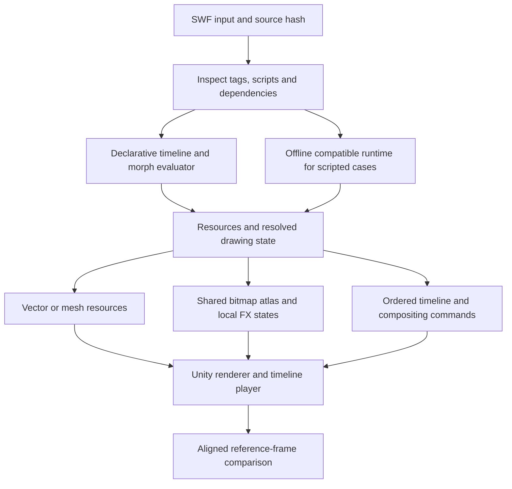

# Spider's converter: changing shapes, smoke, lightning, and a reproducible design

Research date: October 11, 2026. This is an evidence-backed reproduction design. Spider's exporter source and output schema were not available; proposals below are explicitly our design, not recovered Artix Entertainment internals.

## The correction

Moving pre-existing rigid parts explains only one category of Flash animation. A general visual converter also needs **changes to the artwork being drawn**, including paired vector-path morphs, replacement drawings, dynamic graphics/bitmaps, and compositing operations. These are tractable rendering operations. The converter does not need to infer that a collection of shapes represents smoke or lightning.

The essential separation is between **evaluating the source animation** and **representing the evaluated result in Unity**. A shape tween can remain a path plus a morph ratio, become cached meshes for the ratios actually used, or become a sequence of small raster regions. All three preserve a visibly changing silhouette. A screenshot or promotional animation cannot distinguish them.

## What was actually examined

The [October 9 Kickstarter update](https://www.kickstarter.com/projects/artix/adventurequest-worlds-infinity/posts/4823178) reports an automatic animation converter and a custom animation format with a smaller memory footprint. It does not disclose its input format, memory baseline, runtime representation, or complete supported-feature list.

The two animated assets were inspected frame by frame, rather than relying on the user's static screenshots. Kickstarter serves the downloaded assets as **animated WebP despite their `.gif` filenames**:

| Asset | Encoded dimensions | Distinct full frames | Encoded duration |
| --- | --- | --- | --- |
| Single mannequin/cape example | 256 × 256 | 48 | 1,920 ms |
| Eight-example collage | 608 × 783 | 11 | 720 ms |

Those are properties of the embedded media, not measurements of the Unity player frame rate or the source Flash timelines. The collage's blue effect visibly changes outline. Neither that observation nor the cape's changing appearance identifies the underlying Flash operation.

[Focused blue-effect frame sheet](C:/Users/jesse/OneDrive/Desktop/Projects/InfinityServer/outputs/flash_converter_research/blue_effect_contact.png) · [Full collage sheet](C:/Users/jesse/OneDrive/Desktop/Projects/InfinityServer/outputs/flash_converter_research/5846a4f6eae48357_contact.png) · [Cape sheet](C:/Users/jesse/OneDrive/Desktop/Projects/InfinityServer/outputs/flash_converter_research/4483ddee09d6b72c_contact.png)

### Actual compiled AQW files contain the missing mechanism

A previously preserved, selected sample at `C:/Users/jesse/OneDrive/Desktop/XAMPP/aqw_art_reference_sample` was read without changing its inputs. Current measurements:

- 63 SWFs inspected; no errors reported by the structural tag walker.
- 19 contain explicit morph definition tags, totaling 241 definition tags across files.
- 50 have a one-frame root but multi-frame nested timelines.
- Counted root `ShowFrame` tags agree with root header frame counts in this sample.

This is a structural inventory of a selected corpus, not complete SWF conformance validation, an AQW-wide prevalence estimate, or proof that every definition is visibly played. The sample assets have not been identified as the equipment in Spider's demonstration.

Three files were copied into the research output directory and hash-checked against their originals. Installed JPEXS 25.1.3 independently decoded those copies to XML:

| File | Root frames / source FPS | Morph definitions | Longest nested timeline |
| --- | --- | --- | --- |
| `items__swords__OmegaRapier.swf` | 1 / 24 | 3 | 16 frames |
| `items__daggers__CC26VArmaments.swf` | 1 / 24 | 62 | 194 frames |
| `mon__Waterelemental.swf` | 1 / 24 | 5 | 416 frames |

The XML contains placement updates with actual changing morph ratios, not just unused morph definitions. In OmegaRapier, sprite 9 at depth 1 uses morph 5 at ratios 0; 13,107; 26,214; 39,322; 52,429 on frames 1–5. Morphs 6 and 7 replace it on frames 6 and 11; static shape 8 replaces it on frame 16. The declarative parent-frame-one placement chain is root → sprite 24 → sprite 12 → sprite 9. Sprite 12 applies an additional color transform and 5-by-5 blur to the effect.

A placement can omit its character ID and inherit the character already occupying that depth; interpreting an omitted ID as zero would break this sequence. Other optional XML fields likewise require their presence flags. Runtime scripts can still alter playback, so declarative reachability and XML state are distinct from an authenticated game render.

JPEXS also **rendered all 16 isolated sprite-9 frames successfully**. Each RGBA frame is distinct, and the changing contour is visible in the [morph contact sheet](C:/Users/jesse/OneDrive/Desktop/Projects/InfinityServer/outputs/flash_converter_research/omega_morph_contact.png). This render excludes the parent transformations, blur/color transform, other weapon layers, and ActionScript execution. It demonstrates an actual compiled AQW morph through a second renderer; it does not establish original Flash or Unity equivalence.

[trace_morph_evidence.py](C:/Users/jesse/OneDrive/Desktop/Projects/InfinityServer/outputs/flash_converter_research/trace_morph_evidence.py) reproduces the bounded display-list trace and contact sheet. [morph_playback_evidence.json](C:/Users/jesse/OneDrive/Desktop/Projects/InfinityServer/outputs/flash_converter_research/morph_playback_evidence.json) records effective character/ratio states, source/XML hashes, parent context, XML cross-checks, render scope, and the JPEXS render command.

The source inventory helper is [analyze_evidence.py](C:/Users/jesse/OneDrive/Desktop/Projects/InfinityServer/outputs/flash_converter_research/analyze_evidence.py). [evidence_inventory.json](C:/Users/jesse/OneDrive/Desktop/Projects/InfinityServer/outputs/flash_converter_research/evidence_inventory.json) records source paths, SHA-256 hashes, tag counts, timelines, and media timings; [inventory_summary.json](C:/Users/jesse/OneDrive/Desktop/Projects/InfinityServer/outputs/flash_converter_research/inventory_summary.json) contains the compact totals. The helper parses FWS/CWS tag structure; it is not a renderer, ActionScript interpreter, or converter.

## What a lightning or smoke animation can actually be

| Source mechanism | How the changing picture arises | Faithful reproduction route |
| --- | --- | --- |
| Reused symbols | Several puffs, sparks, or streaks move, rotate, scale, recolor, and fade independently | Shared shapes/textures plus instance state and nested clocks |
| Replacement drawings | Different contours appear on successive frames | Resource-ID changes selecting unique vector drawings or atlas regions |
| True shape morph | Corresponding edges, control points, fills, and line styles vary with a stored ratio | Evaluate paired paths; tessellate and cache, or rasterize sampled states |
| Animated clipping | A changing mask reveals or hides another drawing | Preserve clip scope, animated mask state, and ordering |
| Filters and blending | Blur, glow, alpha, screen/add/multiply, and group isolation change the composite | Matching shader/filter passes and temporary surfaces, or a validated subtree bake |
| ActionScript drawing/spawning | Scripts generate geometry, modify bitmaps, create instances, or choose frames | Execute in a compatible offline source runtime and capture output; preserve required interactive cases separately |

Real effects can combine several rows. An animated smoke plume could be morphing gradient-filled shapes with blur, many fading sprites, or script-updated BitmapData. Visual appearance does not establish which. AIR's [noise-texture documentation](https://airsdk.dev/docs/development/display/working-with-bitmaps/making-textures-with-noise-functions) gives a concrete bitmap route to cloud/smoke-like imagery; an exporter for that route must capture texture updates as well as transforms.

## True morphs are explicit data, not something to guess from pictures

Adobe's [SWF 19 specification, shape-morphing chapter](https://open-flash.github.io/mirrors/swf-spec-19.pdf#page=145) defines paired start/end shape data and placement ratios. At ratio 0 the start state is used; at 65,535 the end state is used. In simplified floating-point notation:

```text
t = ratio / 65535
point = startPoint * (1 - t) + endPoint * t
```

The same principle applies to corresponding curve controls and supported style parameters. Source easing is reflected in the sequence of ratios; assuming evenly spaced ratios would lose it.

Ruffle provides a working, inspectable implementation in [morph_shape.rs](https://github.com/ruffle-rs/ruffle/blob/master/core/src/display_object/morph_shape.rs). `build_morph_frame` evaluates source shape records and styles, with conversion where corresponding edges use different straight/curve forms. `get_shape` caches results by ratio and registers geometry with the renderer. Its implementation demonstrates how a compiled SWF can supply the required information without an original FLA.

For our implementation, interpolate the **source paths before tessellation**. Do not assume that triangle vertex 17 in the start mesh corresponds to vertex 17 in the end mesh. Independent triangulation can change topology around holes, crossings, or different subdivisions. Safer options are path interpolation plus tessellation, a cache of the used ratios, or a raster sequence for the affected subtree. Ruffle's [shape processing](https://github.com/ruffle-rs/ruffle/blob/master/render/src/shape_utils.rs) and [tessellator](https://github.com/ruffle-rs/ruffle/blob/master/render/src/tessellator.rs) supply additional implementation references.

## Existing converters already demonstrate two important solutions

### Evaluate source tweens, then export changing artwork

BlackMATov's open [Flash Animation Toolset](https://github.com/BlackMATov/unity-flash-tools) does not merely record transforms. In [FTMain.jsfl, lines 748–788](https://github.com/BlackMATov/unity-flash-tools/blob/main/Assets/FlashTools/FlashExport/Internal/FTMain.jsfl#L748-L788), its Animate-side exporter converts shape tweens into frame-by-frame animation. Later `rasterize_all_shapes()` produces bitmap artwork. The morphing outline therefore survives as changing local artwork, even though it is no longer a continuous vector morph in Unity.

Its [Unity importer](https://github.com/BlackMATov/unity-flash-tools/blob/main/Assets/FlashTools/Scripts/Editor/FTEditor/Postprocessors/SwfAssetPostprocessor.cs#L372) constructs transformed textured quads with atlas coordinates, color data, ordering, masks, and blend groups. The [runtime asset](https://github.com/BlackMATov/unity-flash-tools/blob/main/Assets/FlashTools/Scripts/FTRuntime/SwfClipAsset.cs) stores cached frame meshes. This is a concrete explanation for complex-looking animations with reusable artwork.

It is not a drop-in solution for arbitrary original AQW SWFs: its [context executor](https://github.com/BlackMATov/unity-flash-tools/blob/main/Assets/FlashTools/Scripts/Editor/FTSwfTools/SwfContextExecuter.cs) ignores `DoABC`, and its [postprocessor](https://github.com/BlackMATov/unity-flash-tools/blob/main/Assets/FlashTools/Scripts/Editor/FTEditor/Postprocessors/SwfPostprocessor.cs#L178-L194) warns about unsupported runtime filters. It depends on authoring-side preparation. No AQW compatibility run or modern Unity benchmark was performed here.

Adobe's own [atlas export documentation](https://helpx.adobe.com/animate/desktop/workspace-and-workflow/create-sprite-sheet.html) describes unique artwork plus `Animation.json`, duplicate consolidation, and a Unity sample importer/effect shader. That is another authoring route worth testing if original FLAs and compatible Animate are available.

### Let Flash execute, then record its resolved display list

GAF's [conversion-mode documentation](https://www.gafmedia.com/documentation/conversion-modes-plain-and-nesting) describes a Plain mode that runs the SWF in Flash Player, executes AS3, and records the display list each frame. Its Nesting mode preserves separate timelines but removes general AS3 and supports a limited playback/event subset. The distinction is crucial: **executing source code while exporting its observed result is different from translating arbitrary ActionScript into Unity code**.

Its [format description](https://www.gafmedia.com/documentation/what-is-gaf-format) uses reusable raster artwork and binary frame-state changes. The open [GAF frame decoder](https://github.com/CatalystApps/Cocos2dxGAFPlayer/blob/release-gaf-5/Library/Sources/TagDefineAnimationFrames2.cpp) handles instance identity, depth, transforms, colors, masks, and filter parameters. The [filter manager](https://github.com/CatalystApps/Cocos2dxGAFPlayer/blob/release-gaf-5/Library/Sources/GAFFilterManager.cpp) shows GPU blur/glow passes and render-target caching. These are architectural precedents; current product availability, suitability, and exact Flash-equivalent behavior were not established.

## What Spider could plausibly have built

The most defensible inference is a visual compiler that preserves both reusable content and changing drawing states, with a compact player. At least three representations fit the public evidence:

1. **Atlas artwork plus timeline state:** rasterize unique drawings, including sampled morph states; preserve matrices, colors, layering, masks, and timing.
2. **Vector or cached-mesh playback:** preserve shape/morph data or evaluated meshes, avoiding a bitmap for each changing drawing.
3. **A hybrid:** use reusable shapes/parts normally and local raster fallbacks for expensive or unsupported effect subtrees.

Any can produce the visible results and could reduce memory against a heavier earlier pipeline. The GIF and the phrase “custom format” do not rank them conclusively. A new format might avoid duplicated geometry, animation curves, per-part objects, or full-frame textures. No public schema or measured baseline was found.

Historical notes establish progress, not the new implementation. [May 2023 meeting notes](https://aq2d.com/posts/super_push/) mention experiments with “Flash Animation Tool Set,” while [June 2023 notes](https://aq2d.com/posts/sound_fx_and_music/) describe original FLAs, exported animations, and PNG parts. The name similarity does not prove use of the BlackMATov repository. [September 2024 notes](https://aq2d.com/posts/friday_the_13th_pirate/) state that certain impressive monster effects used traditional sprites. Those examples need not share the October 2026 pipeline.

A bounded read-only inspection of the installed October 9 Steam client found no positively identifiable new converter runtime. Class names and the inspected combat/sprite types did not reveal its format. This cannot establish absence: the exporter could run entirely offline, emit standard Unity assets, use unobvious names, or target a private development build.

## Proposed recreation for the assets we actually have

We have compiled SWFs in the preserved sample. Start with them; do not make original FLA availability a prerequisite. Use two complementary compilation paths feeding one visual intermediate representation:



### First implement the declarative case

OmegaRapier is the first target because it already contains genuine morph placement changes. Reconstruct its display lists, including modifications that inherit prior state. Resolve the nested sprite containing the effect, evaluate each stored ratio, and export the resulting drawing resources. Preserve its parent color/filter context and attachment origin. This produces a meaningful test of the missing capability before attempting general scripting.

A simple first runtime can select pre-evaluated vector meshes or local textures at 24 source frames per second. Continuous morph interpolation is optional; reproducing the source's discrete frames already preserves its intended contour changes. Preserve independent child playback and lifetime/reset semantics. A root with one frame is not a static asset.

### Use a source runtime for procedural cases

For ActionScript-generated drawing or texture changes, a practical engineering path is an **instrumented, pinned Ruffle build used offline**, rather than shipping the whole Flash runtime in Unity. This is a proposed exporter, not an existing Ruffle export mode.

Its [renderer backend boundary](https://github.com/ruffle-rs/ruffle/blob/master/render/src/backend.rs) exposes shape/bitmap registration, frame submission, offscreen rendering, filtering, and texture updates. [Drawing registration](https://github.com/ruffle-rs/ruffle/blob/master/core/src/drawing.rs) connects dynamic source graphics to renderer resources. Capture resource creation/mutation as well as resolved drawing commands, cache entries, and filter passes. Capturing only the final command list would miss necessary bitmap/dynamic-resource changes and intermediate surfaces.

Create a deterministic harness with the expected root, parents, equipment slots, animation labels, color customization values, and relevant inputs. Advance explicit source ticks. Compare the reference with compatible original Flash/AIR playback where available; emulator support must be verified on the representative assets. Ruffle's command-line export options alone are not proof that nested/root-one-frame clips are fully captured.

An observed scripted loop covers that scenario. It does not preserve unseen branches, arbitrary randomness, mouse-following effects, or external game state automatically. For those, export explicit variants, implement the supported behavior, or retain the needed source-runtime behavior. Record the coverage boundary per asset.

### Intermediate representation

Begin with inspectable data, then compress after visual correctness. Our proposed format needs:

```text
Resources
  immutable shape paths / cached meshes
  morph endpoint paths and styles, or evaluated state resources
  shared atlas regions and original local bounds
  mutable bitmap versions, if used

Timeline state and operations
  place / modify / replace / remove, with instance lifetimes
  resource ID and full affine matrix
  RGBA multiply and add, depth and visibility
  morph ratio or evaluated-resource ID
  nested clock and play / stop / goto state
  mask scopes, group isolation, blend and filter parameters
  explicitly supported events

Provenance and validation
  source hash, compiler/runtime versions, capture scenario
  source timebase, coordinate conventions, scaling
  fallback decisions and unsupported/untested behavior
```

Use a resource cache and compact instance arrays; a separate GameObject and AnimationClip for every puff is not required. Delta commands, held states, shared definitions, and seeking checkpoints can reduce overhead. Painter order and compositing boundaries determine batching; texture sorting must not reorder the picture.

## The details that make or break effects

- **Nested clocks:** each MovieClip instance has placement age and playback state. Flattening independently looping children can create an unnecessarily long combined loop; retaining their clocks avoids that multiplication. Seeking and restarting must reconstruct them consistently.
- **Full affine transforms:** retain skew/reflection and explicit local bounds. Tight atlas cropping must not move an effect's origin or attachment pivot.
- **Group opacity and filters:** fading each child separately can differ from fading a composited group where children overlap. Some scopes require rendering to an intermediate surface.
- **Backdrop-dependent blending:** a normal alpha texture is not a general replacement for additive/screen/multiply/erase behavior. Preserve the mode or restrict a bake to cases with equivalent compositing. Test on light, dark, and checkerboard backgrounds.
- **Glow and blur extents:** filter bounds can exceed the original shape bounds. Cropping too tightly clips smoke and halos. Temporary render targets count toward memory.
- **Custom colors:** keep recoloring semantics where gameplay changes colors. A fully baked colored effect cannot automatically respond to later customization; use retained color transforms/masks or explicit variants.
- **Caching:** changing a morph ratio, source bitmap, inherited color, mask, scale, or filter can invalidate cached output. Cache keys must include every property actually baked into the result.
- **Timing:** distinguish source ticks from Unity display frames. Do not invent interpolation across a frame that replaces a drawing or resets an effect.

## Why changing drawings can still be memory-efficient

Illustrative raw RGBA8 pixel arithmetic:

```text
40 complete 512 × 512 frames = 40 MiB
40 local      64 × 64 FX states = 0.625 MiB
```

The latter still needs the reusable weapon/body artwork and animation metadata. These are area calculations, not measured Spider results or a promised compression ratio. Atlas padding, mipmaps, compression, masks, transient surfaces, mesh data, and caches alter resident memory.

This explains why a morphing lightning effect does not force the whole character to become a huge sprite sheet. Only the changing artwork needs changing resources. A vector path plus ratio may be even more compact; complex tessellation and geometry caches can also cost more. Measure the alternatives on actual assets instead of assuming vectors always win.

## A concrete acceptance gate

1. Reproduce OmegaRapier's actual morph sequence and parent compositing, with a source hash and deterministic start state.
2. Add a second asset exercising soft alpha/blur or glow, plus an animated mask and independently looping child clips. Choose it by inspected operations, not the item's name or visual theme.
3. Compare aligned reference and Unity frames on dark, white, and checkerboard backgrounds. Inspect contours, translucent overlaps, glow bounds, and pivots; document tolerances for renderer edge differences.
4. Exercise pause, seek, reset, looping, color changes, equip/unequip, and repeated placement. Detect cache or resource growth after warm-up.
5. Measure decoded textures, meshes, metadata, effect surfaces, CPU frame work, GPU work, allocations, and upload size separately.
6. Integrate an equipment attachment into the client only after the isolated player passes. The rendered result is the completion proof; parsed tags and successful bundle loading are earlier evidence layers.

No Unity converter or player has been built in this research pass, and no end-to-end conversion or performance result is claimed. The work establishes real source mechanisms, an independently rendered AQW morph example, existing implementations, a reproducible evidence trail, and a specific prototype capable of testing the objection directly. Original assets, the installed client, and live services were not changed.
