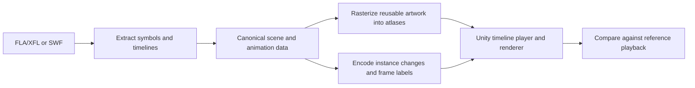

# Recreating the capabilities of Spider's animation converter

Research date: October 11, 2026. This is a reproduction design, not an implementation or a description of Spider's private source code.

**Follow-up:** [Animated effects and actual AQW morph evidence](C:/Users/jesse/OneDrive/Desktop/Projects/InfinityServer/docs/FLASH_TO_UNITY_EFFECTS_RESEARCH.md) expands this design with examination of the actual Kickstarter animations, a 63-file local SWF inventory, independently decoded morph placements, and source-code audits of existing converters. The original rigid-part explanation was incomplete: changing drawings, true morph paths, dynamic bitmap content, and compositing must also be preserved.

## What the public evidence establishes

| Evidence | What it tells us | What it does not establish |
| --- | --- | --- |
| [AE meeting notes, June 7, 2023](https://aq2d.com/posts/sound_fx_and_music/) | Spider used original FLAs, exported animations and separately labeled PNG parts, then assembled them in Unity. Notes mention `.anim` files per label and increased size from rotation keys. | That the October 2026 tool uses this same implementation. |
| [Monster Making 101, November 19, 2023](https://aq2d.com/posts/monster_making_101/) | His tools exported part pivot information; deeply nested animation and inconsistent authoring complicated conversion. | A general solution for arbitrary nested timelines. |
| [16,600 armor conversion, May 9, 2024](https://aq2d.com/posts/16_thousand_aqworlds_armors_converted/) | Bulk equipment conversion initially lacked animation, armor color customization, and special functionality. | That current armor conversion still has all these restrictions. |
| [Battleon Briefing 12, October 5, 2026](https://aq2d.com/quick-posts/battleon-briefing-vol-12/) | AE describes an early proprietary animation exporter built by Spider. | Its input format, file schema, algorithm, or supported feature list. |
| [Kickstarter update, October 9, 2026](https://www.kickstarter.com/projects/artix/adventurequest-worlds-infinity/posts/4823178) | AE reports automatic animated examples, a custom animation format with a smaller memory footprint, and possible future cutscene conversion. | Whether input is FLA, XFL, SWF, or a combination; what memory baseline was measured; universal conversion or ActionScript compatibility. |

The last post was read through the browser in this conversation. The ordinary web reader could not retrieve it.

## Working hypothesis

A plausible architecture is a compiler for Flash's visual scene and timelines plus a purpose-built Unity renderer/player. It exports reusable artwork and changing visual states, then records how instances and their drawing resources change over time. True morphs can retain path data and ratios, use cached evaluated geometry, or become local raster sequences. This is an inference, not a discovery of Spider's method.



It helps to treat the format as three related things:

- **Definitions:** reusable shapes, bitmaps, and clips.
- **Instances:** particular placements of a definition, with their own identity, transform, color, mask context, and playback state. Two wings can reuse artwork while animating independently.
- **Timelines:** ordered changes to the instances and named points such as Idle and Attack.

Do not flatten a multi-frame MovieClip into one static sprite. Descend into it, or explicitly bake that animated subtree as a fallback. Do not reset a child clip every time its parent advances a frame.

## Two input routes

### Original authoring files

Use Adobe Animate's JSFL API to inspect the document library, timelines, layers, frames, and elements and to export artwork. Its [official API overview](https://github.com/AdobeDocs/developers-animatesdk-docs/blob/master/Introduction/JavaScript_API_objects.md) exposes those concepts. Alternatively, parse XFL, but then we must evaluate more authoring semantics ourselves.

This route retains more authoring information and can use Animate as the rasterization and tween-evaluation reference. It requires access to authoring files and, for JSFL, an installed compatible Animate version. An exporter must handle Graphic symbols' synchronization and MovieClips' independent playback separately.

### Compiled SWFs

Start by inspecting the file rather than attempting automatic C# translation. [JPEXS's documented CLI](https://github.com/jindrapetrik/jpexs-decompiler/wiki/Commandline-arguments) supports tag dumps, SWF-to-XML, and exports of shapes, sprites, scripts, and reconstructed XFL. Reconstructed XFL is not the original source and needs validation.

For a maintained parser reference, [Ruffle's SWF types](https://github.com/ruffle-rs/ruffle/blob/master/swf/src/types.rs) include definitions, sprite timelines, placement/modification/removal, transforms, color transforms, masks, filters, labels, sound, and bytecode tags. Use its parser as a component or study the format; its full runtime is a separate, much larger integration.

SWF timeline transforms are generally compiled frame state, so a visual converter can replay them without reconstructing every original tween curve. ActionScript-generated motion and changes are a different problem. Treat observed scripted playback as a captured scenario, not a proof that all branches are converted.

## Existing implementations to investigate first

[BlackMATov's Flash Animation Toolset](https://github.com/BlackMATov/unity-flash-tools) is MIT licensed and publishes its Unity source. Its [user guide](https://github.com/BlackMATov/unity-flash-tools/blob/main/Assets/FlashTools/Docs/USERGUIDE.md) describes running a JSFL exporter in Flash/Animate that rasterizes graphics and produces a compatible SWF for import. Its documented features include skew, nesting-related timeline features, masks, colors, labels, and most blend modes. Those are project claims to test, not verified compatibility with AQW.

Use it as a baseline and inspect its exporter, intermediate data, player, and shaders before building replacements. There is no evidence here that Spider used it. Modern Unity compatibility and complex AQW content have not been tested in this research.

[GAF's documented conversion settings](https://gafmedia.com/documentation/unity/settings-dialog) provide another architectural reference: reusable atlases, different treatment of nesting, dynamic effects, and baked versus hierarchical runtime objects. No installation, current commercial viability, or licensing suitability was verified.

## Proposed intermediate representation

Begin with readable JSON and explicit conventions. Optimize the encoding only after visual correctness is established. The following is our proposed schema, not an AE format:

```json
{
  "schema": "flash-scene-v1",
  "fps": 24,
  "coordinates": "source-pixels-y-down",
  "definitions": [
    {"id": "shape:17", "kind": "atlas-region", "region": 0},
    {"id": "clip:12", "kind": "timeline", "frameCount": 48}
  ],
  "timelines": [{
    "definition": "clip:12",
    "labels": [{"frame": 0, "name": "Idle"}],
    "frames": [
      {"frame": 0, "ops": [{"op": "place", "instance": 1, "definition": "shape:17", "depth": 5, "matrix": [1, 0, 0, 1, 8, 12]}]},
      {"frame": 1, "ops": [{"op": "modify", "instance": 1, "matrix": [1, 0.1, 0, 1, 9, 12]}]}
    ]
  }]
}
```

The example is deliberately incomplete. Production data also needs source fingerprints, atlas bounds and origins, color multiplication and addition, placement lifetimes, mask scopes, nested clock policy, loop/stop behavior, events, sounds, and an unsupported-feature report. Label ranges must be defined explicitly or derived under a documented rule; arbitrary labels do not automatically define valid gameplay clips.

Keep full affine matrices. With `[a,b,c,d,tx,ty]`, define `x' = a*x + c*y + tx` and `y' = b*x + d*y + ty`. This preserves skew and reflection without assuming every transform can be represented by an ordinary Unity Transform's position/rotation/scale. A custom quad/mesh renderer can apply the matrix directly. Coordinate conversion belongs at a documented boundary, including twips-to-pixels if reading SWF.

Keep each exported region's original local bounds. Tight cropping and atlas packing otherwise change its apparent pivot. The rasterization scale should consider maximum intended on-screen scale, rather than assuming a tiny source symbol will never be enlarged.

## Memory and performance hypothesis

An uncompressed RGBA8 512 by 512 image occupies 1 MiB. Sixty distinct frames occupy 60 MiB before mipmaps and other overhead. A reusable parts atlas plus transform data can be much smaller if the animation mainly rearranges the same artwork. This is arithmetic illustrating the proposed design, not an AE benchmark. Texture compression, unique drawn frames, scale, filtering, and effects change the result.

Potential optimizations include shared definition tables, change-only frame commands, deduplicated raster content, run-length encoding of holds, and bounded numeric quantization. Keyframe checkpoints can make seeking efficient. Validate quantization against a visual error budget. Compare decoded resident memory and playback allocations as well as compressed download size.

A smaller animation file alone does not prove lower total memory or faster rendering. Large atlases, render targets for effects, and per-part GameObjects can dominate. Batch only where Flash's painter order and blend/mask boundaries permit it; globally sorting by texture can change the picture.

## Features that determine whether it works

| Feature | Required treatment |
| --- | --- |
| Skew, reflection, unusual pivots | Preserve affine matrices and local bounds; verify with asymmetric test artwork. |
| Nested animation | Instance-specific clocks, placement age, synchronization policy, stops and loops. |
| Painter order and masks | Ordered traversal and scoped masks; nested mask behavior must be tested. |
| Color transforms | Multipliers plus offsets, with documented alpha/color-space conventions. Color customization needs semantic region mapping as well. |
| Blend modes and filters | Matching shaders or isolated render targets; bake only when the fallback preserves required behavior. |
| Morph shapes and newly drawn frames | Tessellate/evaluate geometry or rasterize distinct states; do not force all animation into rigid transforms. |
| ActionScript | Identify timeline control, runtime drawing, external loads, and event logic. Translate a deliberately supported subset or report a hold. |
| Cutscenes | Visual conversion plus text, audio, branching, player insertion, and game events. A visually correct movie is not automatically a working interactive scene. |

There is no public evidence in these sources that AI is required. The known visual data is structured enough for deterministic conversion; the difficult work is preserving semantics and handling exceptions.

## First experiment and acceptance criteria

1. Start with a genuine changing-shape effect rather than a rigid cape. The preserved `OmegaRapier.swf` sample has three morph definitions and a 16-frame nested timeline with changing ratios, making it a concrete first test. Inventory its nested clips, scripts, masks, filters, and morphs before selecting the conversion route; establish reference playback before claiming success.
2. Establish a reference capture at the source frame rate and a fixed scale, background, and animation start. Add a synthetic clip with a skewed part, asymmetric pivot, two independently looping children, and a placement/removal boundary to expose structural mistakes.
3. Evaluate the existing open-source toolset on the authoring-file route. For SWF-only input, extract the display-list timeline and reference images separately. Keep every fallback and unsupported feature visible in the report.
4. Play the exported data in an isolated Unity scene with play, pause, seek, restart, and loop controls. Preserve source frame timing first. Optional interpolation is a separate feature: it can change the intended pose and should not interpolate across discontinuities.
5. Compare aligned frames with image differences and visual overlays. Define tolerances for rasterization edges; inspect masked overlaps and partially transparent effects. Measure repeated-play stability, seek behavior, decoded texture/animation memory, CPU time, and managed allocations after warm-up.
6. Only after the independent player passes, adapt it to an Infinity equipment attachment and verify equip, combat, unequip, scene change, and re-equip behavior in the rendered client.

First milestone: a real animated asset survives restart, looping, and seeking with verified pivots, layering, and child timing. That is a useful result even before scripts, complicated filters, or whole cutscenes are supported. No reliable full-project estimate is possible until the representative sample corpus exposes the exceptions.

## What this workspace currently contributes

- `capture/harvest_bundle.py` already uses UnityPy to inspect Unity bundles. It is a bundle downloader/name inspector, not a Flash converter.
- `docs/decomp/EntityAnimationControl.cs` exposes a Unity Animator-driven gameplay animation layer and event queues. The inspected file's modification timestamp is June 13, 2026; this snapshot cannot establish the October converter's runtime or prove its absence.
- `capture/harvest/bundles/70955_Characters.unity3d` and other local bundles offer existing Unity reference material. The Characters bundle's local timestamp is July 1, 2026; it is not evidence of the new exporter.
- The initial targeted workspace inventory found no original FLA/XFL/SWF inputs. Follow-up research located the preserved 63-file SWF sample at `C:/Users/jesse/OneDrive/Desktop/XAMPP/aqw_art_reference_sample`; its structural inventory and three copied-file JPEXS XML decodes are documented in the effects follow-up.
- The loader offers a potential later attachment point. A compiled bundle does not supply the original exporter, and a new custom MonoBehaviour needs a matching runtime assembly in the client.

Research performed: primary-source review, animation-frame inspection, targeted local source/file inspection, structural SWF analysis, JPEXS XML decoding of copies, and rendering of OmegaRapier's 16-frame morph effect in JPEXS. No Unity converter was built or benchmarked. No client or live service was changed.
